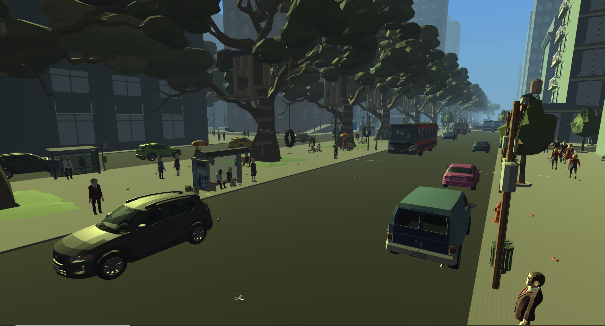

# 🕷️ Web Slinger — Unity Game

A 3D, first-person, open-world superhero game developed in Unity, featuring web swinging, combat, exploration, and mission-based gameplay.

🎮 **Play the Game:** [Web Slinger on itch.io](https://thodoristolis.itch.io/webslinger)

## 📌 Overview

Web Slinger is an open-world superhero game that lets players explore a city, swing between buildings, fight enemies, and complete missions.

The game combines web-swinging traversal with web-shooting combat and exploration in a low-poly 3D environment.

The project was developed in Unity and published on itch.io.

## ✨ Features

### 🕸️ Web-Swinging Mechanics
- Swing through the city using web-based movement.
- Attach webs to buildings while airborne.
- Use swing boosts to build momentum.

### 👊 Combat System
- Punch enemies and shoot webs.
- Fight against three types of enemies.
- Combine movement and combat during encounters.

### 🌆 Open-World Exploration
- Explore a large 3D city.
- Discover hidden collectibles.
- Interact with NPCs throughout the environment.

### 🎯 Missions
- One main mission featuring a dedicated set piece.
- Two side missions.
- Additional exploration objectives.

## 🛠️ Technologies

- **Unity** — Game engine
- **C#** — Scripting language

## 🎬 Gameplay Preview

## 🚀 Play the Game

The published game is available on itch.io:

👉 https://thodoristolis.itch.io/webslinger

## 👨‍💻 Developer

Developed by **Theodoros Tolis** under the developer name TTGames.

## 📌 Project Status

Released.

See the itch.io page for the downloadable game and additional information.
